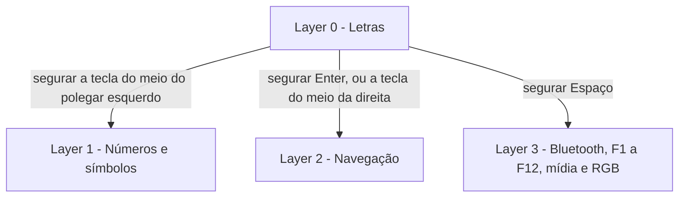

# Corne Wireless com ZMK

A configuração do meu Corne sem fio (split, 3x6 + 3 teclas de polegar), feita para escrever em português e programar com conforto. O firmware é compilado pelo GitHub Actions: você muda um arquivo, dá push, e uns minutos depois os arquivos prontos para gravar estão na aba **Actions**. Não precisa instalar nada no computador.

## Sumário
- [O que tem aqui](#o-que-tem-aqui)
- [Como instalar o firmware](#como-instalar-o-firmware)
- [Layers e layout](#layers-e-layout)
- [Combos e atalhos](#combos-e-atalhos)
- [Escrevendo em português](#escrevendo-em-português)
- [Animações do OLED](#animações-do-oled)
- [Efeitos de RGB](#efeitos-de-rgb)
- [Mapa dos LEDs RGB](#mapa-dos-leds-rgb)
- [Bateria](#bateria)
- [Mudando a configuração](#mudando-a-configuração)
- [Se algo der errado](#se-algo-der-errado)
- [Compilando no seu computador](#compilando-no-seu-computador-opcional)
- [Créditos](#créditos)

## O que tem aqui

**Hardware**
- Teclado: Corne sem fio, com duas metades que se falam por Bluetooth
- Controladores: Nice!Nano v2 (um em cada metade)
- Telas: OLED de 128x32 nas duas metades. O nice!view também está no projeto, mas ainda **não foi testado** nesta versão do ZMK
- LEDs RGB: em cada metade, 21 por tecla e 6 de underglow, todos na mesma fita (veja o [mapa dos LEDs](#mapa-dos-leds-rgb))
- Baterias: uma 18650 de 3450 mAh em cada lado

**Software**
- 4 layers
- Teclas de modificador na linha do meio (segurar o `A`, `S`, `D`, `F`, `J`, `K` ou `L` vira Ctrl, Alt, Shift ou Win)
- Combos para símbolos e acentos
- Telas OLED com animações (gato, Luna e outras), por meio do módulo `zmk-nice-oled`
- Controle de Bluetooth (4 perfis), de mídia e do RGB direto no teclado
- ZMK Studio no lado esquerdo, para editar o keymap sem recompilar

## Como instalar o firmware

### 1. Baixar os arquivos
1. Abra a aba **Actions** do repositório e entre na última execução com o ícone verde.
2. No fim da página, baixe o artefato **firmware** (é um `.zip`) e descompacte.
3. Dentro dele há um arquivo para cada lado. Os nomes mudam conforme a tela que você usa:

| Para o OLED | Para o nice!view |
|---|---|
| `corne_left nice_oled-nice_nano__zmk-zmk.uf2` | `corne_left nice_view_adapter nice_view_gem-nice_nano__zmk-zmk.uf2` |
| `corne_right nice_oled-nice_nano__zmk-zmk.uf2` | `corne_right nice_view_adapter nice_view_gem-nice_nano__zmk-zmk.uf2` |

E um arquivo de limpeza, usado só quando algo dá errado: `settings_reset-nice_nano__zmk-zmk.uf2`.

### 2. Gravar em cada lado
1. Ligue a metade no computador pelo USB.
2. Aperte o botão de **reset duas vezes rápido**. Uma unidade chamada `NICENANO` aparece no computador.
3. Copie o arquivo `.uf2` certo (esquerdo ou direito) para essa unidade.
4. Espere a unidade sumir sozinha. Isso quer dizer que terminou.
5. Repita com a outra metade.

**Dica:** na primeira vez, ou depois de uma mudança grande, grave primeiro o `settings_reset` em **cada lado** e só depois o firmware normal. Isso apaga pareamentos e configurações antigas, e evita muita dor de cabeça. Depois, você precisa parear o teclado de novo com o computador ou o celular.

### 3. Primeiro uso
- O lado **esquerdo** é o que se liga ao computador. Use o USB nele quando quiser digitar com cabo.
- O lado **direito** se conecta ao esquerdo sozinho, e a tela dele mostra um check quando isso acontece.
- O cabo TRRS entre as metades não é usado para comunicação: as duas conversam por Bluetooth.

## Layers e layout

O teclado tem 4 layers (camadas). A principal é a 0, e as outras você acessa segurando uma tecla de polegar.



Nos desenhos abaixo, um ponto (`·`) é uma tecla que não faz nada de novo naquela layer e usa a da layer de baixo. Um `A·GUI` quer dizer "toque para A, segure para Win".

### Layer 0: letras (base)

```
,-------+-------+-------+-------+-------+-------.     ,-------+-------+-------+-------+-------+-------.
|  TAB  |   Q   |   W   |   E   |   R   |   T   |     |   Y   |   U   |   I   |   O   |   P   | BKSP  |
|-------+-------+-------+-------+-------+-------|     |-------+-------+-------+-------+-------+-------|
| CTRL  | A·GUI | S·ALT | D·CTL | F·SFT |   G   |     |   H   | J·SFT | K·CTL | L·ALT |   ;   |   '   |
|-------+-------+-------+-------+-------+-------|     |-------+-------+-------+-------+-------+-------|
| SHIFT |   Z   |   X   |   C   |   V   |   B   |     |   N   |   M   |   ,   |   .   |   /   |  ESC  |
`-------+-------+-------+-------+-------+-------'     `-------+-------+-------+-------+-------+-------'
                        |  WIN  |  L1   |ENT·L2 |     |ESP·L3 |  L2   |  ALT  |
                        `-----------------------'     `-----------------------'
```

Nos polegares:
- **Esquerda:** Win, `L1` (segurar abre a layer 1), `Enter` (toque) ou layer 2 (segurar)
- **Direita:** `Espaço` (toque) ou layer 3 (segurar), `L2` (segurar abre a layer 2), Alt

### Layer 1: números e símbolos

```
,-------+-------+-------+-------+-------+-------.     ,-------+-------+-------+-------+-------+-------.
|   `   |   1   |   2   |   3   |   4   |   5   |     |   6   |   7   |   8   |   9   |   0   | BKSP  |
|-------+-------+-------+-------+-------+-------|     |-------+-------+-------+-------+-------+-------|
|   ·   | RGB ON|RGB OFF|   ·   |   ·   |  F12  |     |   -   |   =   |   `   |   ·   |   '   |   ·   |
|-------+-------+-------+-------+-------+-------|     |-------+-------+-------+-------+-------+-------|
|   ·   |EXT PWR|   ·   |   ·   |   [   |   ]   |     |   ·   |   ·   |   ·   |   ·   |   \   |   ·   |
`-------+-------+-------+-------+-------+-------'     `-------+-------+-------+-------+-------+-------'
                        |   ·   |   ·   |   ·   |     |   ·   | SHIFT |   ·   |
                        `-----------------------'     `-----------------------'
```

`EXT PWR` liga e desliga a alimentação externa dos LEDs. `RGB ON` e `RGB OFF` ligam e desligam o efeito.

### Layer 2: navegação e teclado numérico

```
,-------+-------+-------+-------+-------+-------.     ,-------+-------+-------+-------+-------+-------.
|   ·   |  ESC  |   7   |   8   |   9   |   0   |     | HOME  |   ·   |   ↑   |   ·   |   ·   |   ·   |
|-------+-------+-------+-------+-------+-------|     |-------+-------+-------+-------+-------+-------|
|   ·   | CAPS  |   4   |   5   |   6   |   @   |     |  END  |   ←   |   ↓   |   →   |   ·   |   ·   |
|-------+-------+-------+-------+-------+-------|     |-------+-------+-------+-------+-------+-------|
|   ·   |  DEL  |   1   |   2   |   3   |   .   |     |   ·   |   ·   |   ·   |   ·   |   ·   |   ·   |
`-------+-------+-------+-------+-------+-------'     `-------+-------+-------+-------+-------+-------'
                        |   ·   |   ·   |   ·   |     |   ·   |   ·   |   ·   |
                        `-----------------------'     `-----------------------'
```

### Layer 3: Bluetooth, funções, mídia e RGB

```
,-------+-------+-------+-------+-------+-------.     ,-------+-------+-------+-------+-------+-------.
|   ·   |  BT 1 |  BT 2 |  BT 3 |  BT 4 | BT CLR|     |  F1   |  F2   |  F3   |  F4   |  F5   |  F6   |
|-------+-------+-------+-------+-------+-------|     |-------+-------+-------+-------+-------+-------|
|RGB EFR|RGB LIG|RGB EFE|RGB BRI|RGB BRD|RGB VEL|     |  F7   |  F8   |  F9   |  F10  |  F11  |  F12  |
|-------+-------+-------+-------+-------+-------|     |-------+-------+-------+-------+-------+-------|
|   ·   | ANTER | PLAY  | PRÓX  | VOL - | VOL + |     |   ·   |   ·   |   ·   |   ·   |   ·   |   ·   |
`-------+-------+-------+-------+-------+-------'     `-------+-------+-------+-------+-------+-------'
                        |   ·   |   ·   |   ·   |     |   ·   |   ·   |   ·   |
                        `-----------------------'     `-----------------------'
```

- `BT 1` a `BT 4` escolhem com qual aparelho o teclado fala (4 perfis). `BT CLR` apaga o pareamento do perfil atual.
- `RGB LIG` liga e desliga o RGB, `RGB EFE` passa para o próximo efeito e `RGB EFR` volta para o anterior (veja os [efeitos](#efeitos-de-rgb)), `RGB BRI` e `RGB BRD` aumentam e diminuem o brilho, `RGB VEL` muda a velocidade do efeito atual.

## Combos e atalhos

Um **combo** é apertar duas teclas ao mesmo tempo para fazer outra coisa. Aqui, as duas teclas precisam ser apertadas quase juntas (em menos de 50 milissegundos).

| Teclas juntas | Resultado | Para quê |
|---|---|---|
| `Q` + `W` | Esc | Sair de modos e fechar janelas |
| `E` + `D` | ç | Cedilha |
| `A` + `S` | tap dance do `A` | Acentos (veja abaixo). Experimental |
| `R` + `E` | `[` | Colchete esquerdo |
| `U` + `I` | `]` | Colchete direito |
| `D` + `F` | `(` | Parêntese esquerdo |
| `J` + `K` | `)` | Parêntese direito |
| `C` + `V` | `{` | Chave esquerda |
| `,` + `M` | `}` | Chave direita |
| `T` + `Y` | `\` | Barra invertida |
| `G` + `H` | `\|` | Pipe, comum no terminal |

> Os colchetes e o `\` também estão na layer 1, caso você prefira digitar assim.

## Escrevendo em português

**Acentos com toque repetido (tap dance):** o `A` tem um "tap dance": tocar uma, duas ou três vezes seguidas dá versões diferentes da letra. Hoje ele é acionado pelo combo `A` + `S` (veja a tabela de combos). O segundo toque usa a tecla **AltGr** e o terceiro usa **AltGr com Shift**, então o que aparece depende do layout do teclado do seu sistema (por exemplo, "US Internacional"). Se não sair o acento que você espera, ajuste o layout do sistema. Existe também um tap dance para o `E`, mas ele ainda não está ligado a nenhuma tecla.

**Macro `cao`:** digita as teclas C, A, O e um til por AltGr. Também depende do layout do sistema.

O `ç` tem um combo próprio: aperte `E` e `D` juntos.

## Animações do OLED

As telas OLED mostram um painel com status (conexão, bateria, layer) e uma animação. As animações vêm do módulo [zmk-nice-oled](https://github.com/mctechnology17/zmk-nice-oled), e cada uma se liga ou desliga com uma linha no `config/corne.conf`. Todas as opções já estão lá, **comentadas** (com `#` na frente) e com uma explicação. Para usar uma, tire o `#` da linha.

**O que aparece hoje, sem mexer em nada:**
- **Lado esquerdo:** o Bongo Cat, um gato que bate nas teclas. Ele só anima enquanto você digita.
- **Lado direito:** um gato que fica animado o tempo todo.

**Para trocar:**
1. Abra o `config/corne.conf` e procure a seção "Animações do OLED".
2. Tire o `#` da linha da animação que quiser. Se for trocar a que já está ligada, **desligue a antiga** escrevendo `=n` nela (por exemplo, `CONFIG_NICE_OLED_WIDGET_ANIMATION_PERIPHERAL_CAT=n`).
3. Dê commit e push, espere a Action e grave **os dois lados** (veja [Como instalar o firmware](#como-instalar-o-firmware)).

> Eu não testei cada animação no teclado, então os nomes abaixo vêm da documentação do módulo. Teste uma de cada vez. E se o teclado travar depois de ligar uma animação nova, veja a seção [Se algo der errado](#se-algo-der-errado): o display precisa de memória suficiente.

### Lado direito: animação que roda sozinha

| Opção | O que faz |
|---|---|
| `CONFIG_NICE_OLED_WIDGET_ANIMATION_PERIPHERAL` | Liga a animação no lado direito (já vem ligada) |
| `CONFIG_NICE_OLED_WIDGET_ANIMATION_PERIPHERAL_CAT` | Gato (já vem ligado) |
| `CONFIG_NICE_OLED_WIDGET_ANIMATION_PERIPHERAL_GEM` | Gema |
| `CONFIG_NICE_OLED_WIDGET_ANIMATION_PERIPHERAL_HEAD` | Cabeça |
| `CONFIG_NICE_OLED_WIDGET_ANIMATION_PERIPHERAL_POKEMON` | Pokémon |
| `CONFIG_NICE_OLED_WIDGET_ANIMATION_PERIPHERAL_SPACEMAN` | Astronauta |
| `CONFIG_NICE_OLED_WIDGET_ANIMATION_PERIPHERAL_SMART_BATTERY` | Animação de bateria inteligente |
| `CONFIG_NICE_OLED_WIDGET_ANIMATION_PERIPHERAL_MS` | Quanto tempo dura cada volta da animação, em milissegundos |

### Lado direito: imagem parada (sem animação)

Para usar uma imagem fixa, desligue a animação (`..._ANIMATION_PERIPHERAL=n`) e escolha uma:

| Opção | O que faz |
|---|---|
| `CONFIG_NICE_OLED_WIDGET_STATIC_IMAGE_PERIPHERAL` | Mostra uma imagem fixa (vem ligada quando não há animação) |
| `CONFIG_NICE_OLED_WIDGET_STATIC_IMAGE_PERIPHERAL_VIM` | Imagem do Vim |
| `CONFIG_NICE_OLED_WIDGET_STATIC_IMAGE_PERIPHERAL_VIP_MARCOS` | Imagem alternativa (`vim_marcos`) |

### Lado esquerdo: animações que reagem a você

| Opção | O que faz |
|---|---|
| `CONFIG_NICE_OLED_WIDGET_WPM_BONGO_CAT` | Bongo Cat, anima enquanto você digita (já vem ligado) |
| `CONFIG_NICE_OLED_WIDGET_WPM_BONGO_CAT_ANIMATION_MS` | Velocidade do Bongo Cat |
| `CONFIG_NICE_OLED_WIDGET_WPM_LUNA` | Luna, o cachorro, que corre conforme a sua velocidade de digitação (vem desligada; para usar, desligue o Bongo Cat) |
| `CONFIG_NICE_OLED_WIDGET_WPM_LUNA_ANIMATION_MS` | Velocidade da Luna |
| `CONFIG_NICE_OLED_WIDGET_RESPONSIVE` e `..._RESPONSIVE_BONGO_CAT` | Bongo Cat que reage a cada tecla. Usa mais processamento do teclado |

### Animações nos indicadores

| Opção | O que faz |
|---|---|
| `CONFIG_NICE_OLED_WIDGET_HID_INDICATORS_LUNA` | Luna aparece quando o Caps Lock está ligado |
| `CONFIG_NICE_OLED_WIDGET_HID_INDICATORS_BONGO_CAT` | Bongo Cat aparece quando o Caps Lock está ligado |
| `CONFIG_NICE_OLED_WIDGET_MODIFIERS_INDICATORS_LUNA` | Luna reage a Shift, Ctrl e companhia |
| `CONFIG_NICE_OLED_WIDGET_MODIFIERS_INDICATORS_BONGO_CAT` | Bongo Cat reage a Shift, Ctrl e companhia |

Cada uma tem uma opção irmã terminada em `_ANIMATION_MS` para ajustar a velocidade.

### Tela de descanso

| Opção | O que faz |
|---|---|
| `CONFIG_NICE_OLED_SHOW_SLEEP_ART_ON_IDLE` | Mostra uma arte quando o teclado fica ocioso |
| `CONFIG_NICE_OLED_SHOW_SLEEP_ART_ON_SLEEP` | Mostra uma arte quando o teclado entra em deep sleep |
| `CONFIG_NICE_OLED_SLEEP_STATUS_BOOTLOADER` | Mostra por um instante uma imagem de bootloader ao acordar |

> Hoje o display está configurado para **apagar** no idle. Se você ligar a arte de descanso, ela só aparece se o display não estiver apagando, então talvez seja preciso desligar `CONFIG_ZMK_DISPLAY_BLANK_ON_IDLE`. Eu não testei essa combinação.

## Efeitos de RGB

O RGB é controlado pelo módulo [zmk-rgb-matrix](https://github.com/gudzpoz/zmk-rgb-matrix), que permite efeitos que **reagem às teclas** (o ZMK sozinho não tem isso). Os 4 efeitos abaixo ficam no `config/boards/shields/corne/corne-rgb-effects.dtsi`. Para trocar de um para o outro, use `RGB EFE` na layer 3. Ao ligar, o teclado começa no primeiro.

| # | Efeito | O que faz |
|---|---|---|
| 0 | **Reativo** (padrão) | Só a tecla que você apertou acende, em ciano, e vai apagando devagar (uns 1,5 s). O resto fica apagado. Várias teclas ao mesmo tempo acendem juntas |
| 1 | **Ondas** (ripple) | Cada tecla apertada solta uma onda que se espalha pelas teclas vizinhas |
| 2 | **Mapa de calor** (heatmap) | As teclas que você mais aperta ficam "mais quentes" (mudam de cor com o uso) |
| 3 | **Arco-íris** | Um arco-íris que se move pelo teclado, parecido com o antigo swirl |

O RGB **apaga sozinho no idle** (2 minutos parado) e volta quando você digita de novo.

### Mudando os efeitos

No `corne-rgb-effects.dtsi`:

```
max-brightness = <60>;        # teto de brilho (%)
initial-brightness = <30>;    # brilho ao ligar (% do teto)
initial-effect = <0>;         # efeito ao ligar (0 a 3)
color = <0x00FFFF>;           # cor do reativo e das ondas (RGB em hexadecimal)
duration = <1500>;            # quanto tempo o reativo leva para apagar (ms)
```

**Cuidado:** as duas metades precisam ter exatamente os mesmos efeitos, na mesma ordem. Por isso a lista fica num arquivo só, usado pelas duas. Se você acrescentar, tirar ou reordenar efeitos, mexa sempre nesse arquivo (nunca só em uma das metades).

Esse módulo traz outros efeitos além destes quatro. Os que estão no projeto foram escolhidos por serem os mais úteis; veja a documentação do módulo para a lista completa.

## Mapa dos LEDs RGB

Cada metade tem **27 LEDs** ligados em uma só fita: **21 pequenos** (um por tecla) e **6 grandes** de underglow, que ficam na parte de baixo da placa. A placa é a PandaKB Corne V3 (Corne Cherry v3.0.1, do foostan).

### Números gravados na placa

O desenho abaixo mostra o número que está impresso na placa ao lado de cada tecla (o `LEDn`). Um `+` quer dizer que, logo abaixo daquele LED pequeno, existe também um **LED grande** de underglow. Os LEDs grandes não têm um número legível nas fotos.

```
,-------+-------+-------+-------+-------+-------.     ,-------+-------+-------+-------+-------+-------.
| LED7  | LED8+ | LED9  | LED10+| LED11 | LED12+|     | LED39+| LED38 | LED37+| LED36 | LED35+| LED34 |
|-------+-------+-------+-------+-------+-------|     |-------+-------+-------+-------+-------+-------|
| LED13 | LED14+| LED15 | LED16 | LED17 | LED18 |     | LED45 | LED44 | LED43 | LED42 | LED41+| LED40 |
|-------+-------+-------+-------+-------+-------|     |-------+-------+-------+-------+-------+-------|
| LED19 | LED20 | LED21 | LED22+| LED23 | LED24+|     | LED51+| LED50 | LED49+| LED48 | LED47 | LED46 |
`-------+-------+-------+-------+-------+-------'     `-------+-------+-------+-------+-------+-------'
                        | LED25 | LED26 | LED27 |     | LED54 | LED53 | LED52 |
                        `-----------------------'     `-----------------------'
```

Nos polegares, o `LED27` fica sob a tecla do **Enter** (polegar de dentro, lado esquerdo) e o `LED54` sob a tecla do **Espaço** (polegar de dentro, lado direito).

Os números seguem a **ordem de leitura da placa** (linha por linha, da borda externa para a interna), e **não** a ordem em que os LEDs estão ligados entre si. Por isso eles servem para você achar um LED na placa, mas não para saber qual acende primeiro.

### Ordem da cadeia (confirmada no teclado)

Os LEDs de cada metade formam uma fila: o dado entra no primeiro, passa para o segundo, e assim por diante. A ordem abaixo vem do mapa oficial dessa placa no QMK (`crkbd/rev1`) e foi **conferida no teclado**: com o efeito reativo, cada tecla acende o próprio LED. O número em cada tecla é a posição dela na fila (de 0 a 26), e `gN` é o LED grande de underglow que fica abaixo dela (também de 0 a 5):

```
,-------+-------+-------+-------+-------+-------.     ,-------+-------+-------+-------+-------+-------.
| 24    | 23 g2 | 18    | 17 g1 | 10    | 9  g0 |     | 9  g0 | 10    | 17 g1 | 18    | 23 g2 | 24    |
|-------+-------+-------+-------+-------+-------|     |-------+-------+-------+-------+-------+-------|
| 25    | 22 g3 | 19    | 16    | 11    | 8     |     | 8     | 11    | 16    | 19    | 22 g3 | 25    |
|-------+-------+-------+-------+-------+-------|     |-------+-------+-------+-------+-------+-------|
| 26    | 21    | 20    | 15 g4 | 12    | 7  g5 |     | 7  g5 | 12    | 15 g4 | 20    | 21    | 26    |
`-------+-------+-------+-------+-------+-------'     `-------+-------+-------+-------+-------+-------'
                        | 14    | 13    | 6     |     | 6     | 13    | 14    |
                        `-----------------------'     `-----------------------'
```

Lendo o desenho: os 6 LEDs grandes (`g0` a `g5`) vêm primeiro na fila, e depois os 21 pequenos, num caminho em zigue-zague. A fila começa no polegar de dentro (`6`), **sobe** pela coluna de dentro, **desce** pela coluna seguinte, e assim vai até a coluna do dedo mínimo. As duas metades seguem a mesma lógica, espelhadas.

Em termos de teclas do keymap (posições de 0 a 41), a fila dos LEDs pequenos, do 6º ao 27º, é:

| Metade | Posição das teclas, na ordem da fila |
|---|---|
| Esquerda | `38 29 17 5 4 16 28 37 36 27 15 3 2 14 26 25 13 1 0 12 24` |
| Direita | `39 30 18 6 7 19 31 40 41 32 20 8 9 21 33 34 22 10 11 23 35` |

Essa ordem está nos arquivos `corne_left.overlay` e `corne_right.overlay` (nó `rgb_matrix`, campo `mapping`). Os 6 primeiros itens são os LEDs grandes, que não têm tecla, e só a posição deles (aproximada, logo abaixo da tecla) foi estimada.

## Bateria

- **Display:** apaga sozinho quando você para de digitar.
- **RGB:** desliga no idle e volta quando você digita de novo. Pode ser que o lado que você usa menos apague antes do outro.
- **Idle:** 2 minutos sem tocar nas teclas. **Deep sleep:** 30 minutos. Ao acordar do deep sleep, o teclado pode levar alguns segundos para reconectar.
- **Potência do Bluetooth:** 0 dBm. Se o teclado ficar perdendo conexão com o computador, aumente para +4 ou +8 no arquivo `config/corne.conf`.

**A porcentagem da bateria mente um pouco.** O ZMK calcula o número olhando a tensão da bateria, e a tensão cai quando o teclado está sob carga (RGB, tela, Bluetooth). Por isso o número pode cair uns pontos logo depois de ligar e voltar a subir sozinho. Para ver quanto de bateria sobrou de verdade, olhe o número com o teclado parado, depois de uns 2 minutos.

## Mudando a configuração

| Arquivo | Para quê |
|---|---|
| `config/corne.keymap` | O layout: teclas, layers, combos, macros |
| `config/corne.conf` | Opções das **duas** metades: tela, RGB, bateria, sleep e Bluetooth |
| `config/boards/shields/corne/corne_left.conf` | Só do lado esquerdo (ZMK Studio) |
| `config/boards/shields/corne/corne_right.conf` | Só do lado direito (hoje vazio) |
| `build.yaml` | Quais firmwares a Action compila (OLED, nice!view e o de limpeza) |
| `config/west.yml` | Versão do ZMK e dos módulos (telas e RGB) |
| `config/boards/shields/corne/corne-rgb-effects.dtsi` | Efeitos e brilho do RGB (compartilhado pelas duas metades) |
| `config/boards/shields/corne/` | A descrição do hardware do Corne (pinos, matriz, LEDs, OLED) |

**Fluxo normal:** mude o arquivo, dê commit e push, espere a Action ficar verde e baixe o firmware.

A Action roda sozinha quando algo dentro da pasta `config/` muda. Se você mudar **só o `build.yaml`**, ela não dispara: vá na aba Actions e use **Run workflow**.

### Opções que você provavelmente vai querer mexer

**Brilho e efeitos do RGB:** ficam no `config/boards/shields/corne/corne-rgb-effects.dtsi` (veja [Efeitos de RGB](#efeitos-de-rgb)), e não mais no `corne.conf`.

**Tempo de idle e sleep** (em milissegundos):
```
CONFIG_ZMK_IDLE_TIMEOUT=120000          # 2 minutos
CONFIG_ZMK_IDLE_SLEEP_TIMEOUT=1800000   # 30 minutos (precisa ser maior que o idle)
```

**Animações do OLED:** no `corne.conf` há uma lista de todas as animações do módulo `zmk-nice-oled`, comentadas e com uma explicação de cada uma. Tire o `#` da que quiser.

## Se algo der errado

### O teclado trava uns 2 segundos depois de ligar, e as telas congelam
Isso aconteceu quando o módulo da tela OLED recebia pouca memória. A correção está no `corne.conf`:
```
CONFIG_ZMK_DISPLAY_DEDICATED_THREAD_STACK_SIZE=8192
```
**Não diminua esse valor.** Com 3072 (o que o ZMK usa por padrão), o teclado trava.

### O Bluetooth não conecta, ou o lado direito não acha o esquerdo
1. No computador ou celular, remova o "Corne" da lista de aparelhos Bluetooth.
2. Grave o `settings_reset` nos **dois** lados.
3. Grave o firmware normal em cada lado (os dois, com a mesma versão).
4. Ligue os dois e pareie o teclado de novo.

### A tela do OLED está mostrando só pontinhos aleatórios
Costuma ser o que uma tela OLED mostra quando o firmware não a inicializou (ou travou no meio de uma atualização). Se continuar assim depois de gravar o firmware normal, confira se gravou o arquivo certo (o do `nice_oled`) e veja o item sobre o teclado travar, logo acima.

### A Action falhou
Abra a execução com o X vermelho, clique no job que falhou e leia a última parte do log. Os erros mais comuns são uma opção de configuração que não existe mais (o Kconfig reclama de um símbolo indefinido) e um módulo de tela que ainda não funciona com a versão atual do ZMK.

## Compilando no seu computador (opcional)

> Aviso: o download inicial tem uns **5 GB** (o ZMK, o Zephyr e os módulos) e leva alguns minutos. Isso só acontece na primeira vez.

### 1. Baixar o ZMK e os módulos (só na primeira vez)

```sh
docker run --rm -v "$PWD":/workspace -w /workspace zmkfirmware/zmk-build-arm:stable \
  bash -c 'west init -l config && west update'
```

Isso cria várias pastas dentro do projeto (`zmk`, `zephyr`, `modules`, `.west` e as dos módulos). Elas já estão no `.gitignore`, então não aparecem no `git status`. Rode de novo o `west update` (o mesmo comando acima, sem o `west init`) quando mudar o `config/west.yml`.

### 2. Compilar

Lado esquerdo (OLED, com o ZMK Studio):
```sh
docker run --rm -v "$PWD":/workspace -w /workspace zmkfirmware/zmk-build-arm:stable \
  bash -c 'west zephyr-export >/dev/null && west build -s zmk/app -d build/left -b "nice_nano//zmk" -S studio-rpc-usb-uart -- -DSHIELD="corne_left nice_oled" -DZMK_CONFIG=/workspace/config'
```

Lado direito (OLED):
```sh
docker run --rm -v "$PWD":/workspace -w /workspace zmkfirmware/zmk-build-arm:stable \
  bash -c 'west zephyr-export >/dev/null && west build -s zmk/app -d build/right -b "nice_nano//zmk" -- -DSHIELD="corne_right nice_oled" -DZMK_CONFIG=/workspace/config'
```

Os arquivos ficam em `build/left/zephyr/zmk.uf2` e `build/right/zephyr/zmk.uf2`. Grave cada um como na seção [Como instalar o firmware](#como-instalar-o-firmware) (passo 2).

### Outras versões

Troque só o `-DSHIELD` (e a pasta do `-d`):

| Firmware | `-DSHIELD` | Extra |
|---|---|---|
| Esquerdo com nice!view | `"corne_left nice_view_adapter nice_view_gem"` | `-S studio-rpc-usb-uart` |
| Direito com nice!view | `"corne_right nice_view_adapter nice_view_gem"` | |
| Limpeza das configurações | `settings_reset` | |

### Dicas

- O `west zephyr-export` aparece em todo comando porque o container é descartado ao terminar; sem ele, o build reclama que não acha o Zephyr (`Could not find a package configuration file provided by "Zephyr"`).
- Se o build ficar estranho depois de mexer muito na configuração, apague a pasta `build/` e compile de novo.
- Estes comandos são os mesmos que a Action roda (o `build.yaml` diz o que compilar). Se funcionam aqui, funcionam lá.

## Créditos

- [ZMK Firmware](https://zmk.dev)
- [Corne Keyboard, foostan/crkbd](https://github.com/foostan/crkbd)
- Config base: [ZMK Config](https://github.com/zmkfirmware/zmk-config)
- Telas OLED: [zmk-nice-oled](https://github.com/mctechnology17/zmk-nice-oled), com a migração para o ZMK atual feita em [tokyo2006/zmk-nice-oled](https://github.com/tokyo2006/zmk-nice-oled)
- RGB reativo: [gudzpoz/zmk-rgb-matrix](https://github.com/gudzpoz/zmk-rgb-matrix)
- Tela nice!view: [nice-view-gem](https://github.com/M165437/nice-view-gem)

---

Feito por [the spanish guy](https://github.com/the-spanish-guy) com :black_heart:

```
          ／＞　 フ
         | 　_　_|
       ／` ミ__^ノ
      /　　　　 |
     /　 ヽ　　 ﾉ           ╱|、
    /　　 |　|　|         (˚ˎ 。7
／￣|　　 |　|　|          |、˜〵
(￣ヽ＿_  ヽ_)__)         じしˍ,)ノ
＼二)
```
